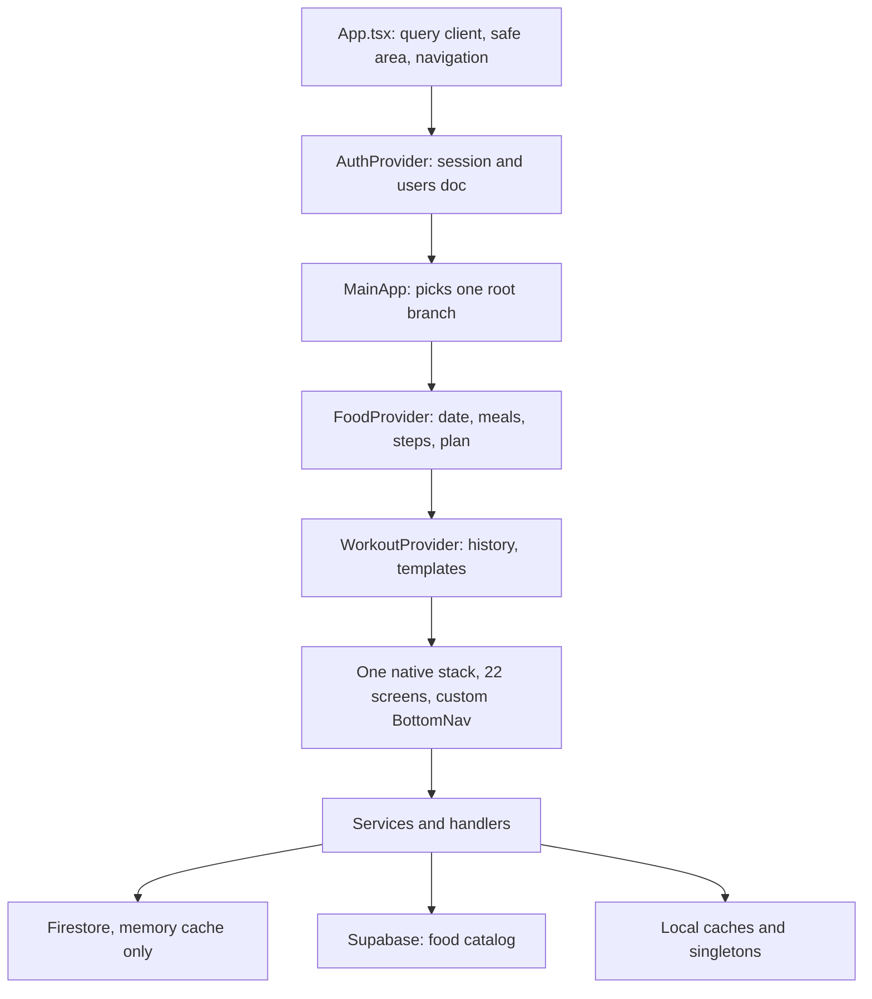
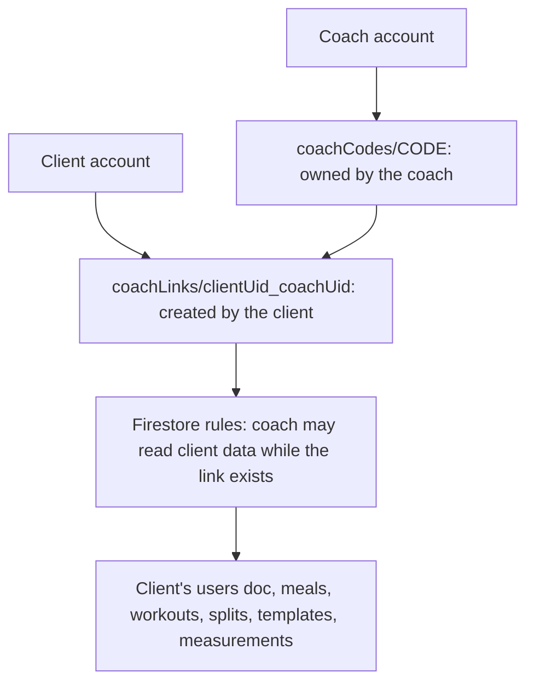
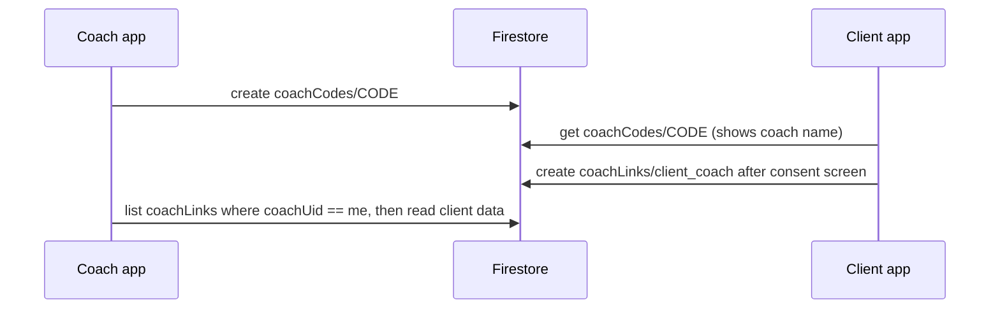

# Uptrack architecture review and coach-role design, October 2026

Design pass, not a fix pass. No application code, configuration, rules or SQL was changed. This file goes with `audit/REVIEW_2026-10.md`. Its findings are `ARCH-001` to `ARCH-007`. `REV-nnn` references point to that review. The coach section is a proposal for a feature that does not exist yet. The owner decides whether and how to build it.

| Short | Stands for | In one line |
|---|---|---|
| SDK | Software development kit | Here mostly the Firebase JS SDK 10.14.1 |
| HC | Health Connect | Android's on-device health data store, read through `react-native-health-connect` |
| PII | Personally identifiable information | Email, age, gender, body measurements and similar |
| GDPR | General Data Protection Regulation | EU privacy law. Health data is a special category under Article 9 |
| Admin SDK | Firebase Admin SDK | Server-side Firebase access that bypasses rules; needed for custom claims |
| Custom claims | Firebase Auth custom claims | Server-set flags in the ID token, readable in rules as `request.auth.token` |

## Scope and method

- Commit `dc0733b2976a4d398d9771ef3d95e19fef948715`, the same as the review.
- Read for this pass:
  - `App.tsx` and `firebase.json`;
  - `firebase/firestore.rules` and `firebase/storage.rules`;
  - `docs/backend-structure.md`;
  - `src/shared/types.ts` (`UserData`, `PlanFormData`);
  - `src/shared/query/queryClient.ts`;
  - `FoodContext.tsx`, `AuthContext.tsx`, `workoutHistoryQuery.ts`, `mealService.ts`, `accountDeletionService.ts`, `WorkoutService.ts`, `exerciseCatalogService.ts` and `BottomNav.tsx`;
  - the signatures of the workout and weight services;
  - `stepsSyncService.ts` (writes `dailySteps` to `users/{uid}` with `setDoc`, line 37) and `accountDeletionService.test.ts`.
- Searches (ripgrep over `src/`):

| Search | Result |
|---|---|
| `auth.currentUser` or `getAuth().currentUser` | 58 occurrences in 27 files |
| `doc(db, 'users'` or `doc(firestore, 'users'` outside tests | 29 sites in 14 files (a lower bound; references built another way are not counted) |
| `fetchQuery`, `useQuery`, `useMutation` outside tests | `fetchQuery` in 6 files; `useQuery` only in `useExerciseCatalog.ts:17`; `useMutation` nowhere |
| `coach`, `role`, `customClaims`, `getIdTokenResult` | no matches |
| `<AppStack.Screen` in `App.tsx` | 22 |

- Not run: madge (dependency graph), knip, jscpd, any rules emulator test of the proposed rules, any device test. Layering statements below come from reading imports in the files listed, not from a full graph.

## How the app is built



- **Arrows** mean "renders" down to the stack, and "calls" from the stack downward.
- **MainApp** chooses between Splash, the sign-in screens, onboarding and the authenticated stack, based on `loading`, `authenticated` and `profileSetupComplete` from `AuthContext.tsx`.
- **FoodProvider and WorkoutProvider** wrap the whole authenticated stack (`App.tsx:53-81`), so every screen sits inside both.
- **Local caches and singletons**:
  - `MealCache` with `meal_cache_v2_{uid}`;
  - the catalog `memoryCache` (`exerciseCatalogService.ts:33`);
  - `workoutService` (`WorkoutService.ts:378`);
  - TanStack Query used through `fetchQuery`;
  - AsyncStorage copies.

| Layer | How it is done | Verdict |
|---|---|---|
| Folder layout | `src/features/<area>/{components,screens,services,handlers,helpers,utils,context}` plus `src/shared` | Good, consistently applied |
| Business logic | Pure engines (`progressEngine.ts`, `nutritionPlanEngine.ts`, learning completion) with unit tests | Good, the strongest part of the codebase |
| Firestore data model | One document per meal day, one per workout, per-user collections with a `uid` field | Good, simple and rule-friendly |
| `users` document | Profile, plan, targets, `weightIns[]`, `dailySteps`, `weeklyNutrition[]`, `phaseHistory[]` in one document | Works today; a problem for any sharing feature (ARCH-004) |
| Server-state handling | Five mechanisms side by side | Weak (ARCH-001) |
| Global state | Three contexts; `FoodContext` publishes 35 fields | Too much in one context (ARCH-002) |
| Identity in services | Some services take `uid`, others read `auth.currentUser` | Inconsistent (ARCH-003) |
| Navigation | One stack, custom bottom bar calling `navigate` | Works, but behaves unlike tabs (ARCH-005) |
| Backend logic | None. `firebase.json` has rules and emulators only, and there is no `functions/` folder | Fine for a single-user app, limiting for multi-user features (ARCH-006) |
| Offline | Firestore memory cache, no network handling | Weak (ARCH-007, REV-031, REV-032) |
| Types | Shared `types.ts`, converters where data enters | Good |

## Findings

### ARCH-001 Server data is fetched, cached and written through five different mechanisms
- Dimension: Architecture
- Severity: Medium
- Confidence: Confirmed
- Where:
  - `src/features/nutrition/context/FoodContext.tsx` (`MealCache`, `getMealCache` in the context value at line 77);
  - `src/features/workout/services/workoutHistoryQuery.ts:38,86,112` (`queryClient.fetchQuery`);
  - `src/features/workout/screens/ExerciseSelectionScreen/useExerciseCatalog.ts:17` (the only `useQuery`);
  - `src/features/workout/services/exerciseCatalogService.ts:33` (its own `memoryCache`);
  - `src/features/workout/services/WorkoutService.ts:378` (singleton);
  - `docs/backend-structure.md:77` (profile documents deliberately uncached).
- What happens: Each data type has its own caching, invalidation and user-switch handling:
  - meals use a hand-written cache with AsyncStorage persistence and optimistic writes with rollback;
  - workout history uses TanStack Query imperatively;
  - the exercise catalog keeps both a module cache and a TanStack Query cache;
  - the active workout lives in a singleton that survives sign-out;
  - profile reads always go to the server.
- Why it matters: Each mechanism needs its own correctness work for date changes, user switches, offline behavior and stale data. Several review findings come from this split:
  - REV-013: "today" is tied to the screen's selected date;
  - REV-019: Progress re-reads meals on every visit;
  - REV-031 and REV-032: offline behavior differs per path.

  A coach view would need a sixth variant unless this is unified.
- Suggested change: Make TanStack Query hooks the single way screens read server data, one data type at a time:
  1. Use `useQuery` with keys that start with the subject uid: `['meals-day', uid, dayKey]`, `['user-profile', uid]`, `['workout-history', uid, ...]`.
  2. Use `useMutation` with `onMutate`/`onError` for optimistic meal writes, replacing the rollback code in `optimisticMealWrite.ts` once a test suite proves it behaves the same.
  3. Optionally, keep the AsyncStorage meal cache as a persister for the query cache, instead of a parallel cache.
  4. Do not rewrite `FoodContext` in one change. Its user-switch and rollback guards have tests that must keep passing at each step.
- Effort: L
- Coach impact: High. With subject-uid keys, a coach screen reuses the same hooks with the client's uid and gets caching and loading states for free.

### ARCH-002 `FoodContext` is one context for six concerns, with side effects inside the provider
- Dimension: Architecture
- Severity: Low
- Confidence: Confirmed
- Where: `src/features/nutrition/context/FoodContext.tsx:46-82` (35 fields in `FoodContextValue`), `:583` (the provider renders `StepDisplay`, which polls steps). The file is 596 lines.
- What happens: The selected date, the day's meals, food categories, learning data, daily totals, steps, range queries and initialization state are all published in one value. Step polling runs as a rendered child component. Background plan evaluation is wired from the same provider (`useFoodBackgroundEvaluations`).
- Why it matters:
  - Any change re-renders every consumer (REV-011).
  - The provider cannot be reused to show another user's data, because it also writes: it syncs steps into the signed-in user's document and runs the weekly evaluation.
- Suggested change: Mostly falls out of ARCH-001. What is left after that:
  - a small `SelectedDateContext` for the date;
  - a `useStepsSync` hook mounted once in `AuthenticatedScreens` instead of a rendered component;
  - the background evaluation as its own hook.

  Do not do this as a separate project before ARCH-001.
- Effort: M (after ARCH-001)
- Coach impact: High. Coach screens must not mount `FoodProvider` for a client, because it would run writes for the signed-in coach.

### ARCH-003 Services decide whose data to read in two different ways
- Dimension: Architecture
- Severity: Low today, Medium for any multi-user feature
- Confidence: Confirmed
- Where:
  - These take a `uid` parameter: `mealService.ts:70,86,121`, `workoutHistoryQuery.ts:34,72,108`.
  - These read the signed-in user internally:
    - `workoutTemplateService.ts:91` (`fetchTemplatesFromFirestore()`);
    - `workoutSplitService.ts:30` (`fetchSplitsFromFirestore()`);
    - `workoutHistoryService.ts:52,72` (`countWorkoutsThisWeek()`, `getLastWorkout()`).
  - 58 `auth.currentUser` reads in 27 files in total, including screens and hooks.
- What happens: Half of the read paths can only ever return the signed-in user's data.
- Why it matters: Reads that hide the uid cannot be reused to show another person's data, and they are harder to test. Write paths reading `auth.currentUser` are fine and should stay that way, because a write must always belong to the signed-in user.
- Suggested change: Give read functions an explicit `uid` parameter, starting with the reads a coach needs: templates, splits, last workout, workouts this week, measurements. Leave write functions alone.
- Effort: S per function, M in total
- Coach impact: Required for the coach's workout views.

### ARCH-004 The `users` document mixes private profile data with progress data, and any module can write any field
- Dimension: Architecture
- Severity: Low today, High for sharing if any profile field must stay private
- Confidence: Confirmed
- Where:
  - `src/shared/types.ts:77-128` (`PlanFormData`, `UserData`);
  - `firebase/firestore.rules:25-27` (`users/{uid}`: owner get, create, update and delete, with no field allow-list);
  - written from 14 files, 29 or more sites (search in Scope);
  - `docs/backend-structure.md:30`.
- What happens: These all live in one document:
  - email, username, age, gender, height, stress level and activity level;
  - weight history (`weightIns[]`);
  - steps (`dailySteps`);
  - weekly nutrition snapshots and phase history;
  - targets and plan internals.
- Why it matters:
  - Firestore rules allow or deny whole documents, not single fields. Anyone given read access to `users/{uid}` sees every field.
  - Because the owner can write any field, a self-written field such as `role: 'coach'` can never be trusted for authorization.
  - Growth is slow (one `weightIns` entry per week, one `dailySteps` key per day), so the 1 MB document limit is not a near-term concern.
- Suggested change: Depends on the coach decision (owner decision 2 below):
  - If coaches may see the whole profile, leave the document as it is and allow coach reads (option B in the coach design).
  - If some fields must stay private, move the shareable data (`weightIns`, `dailySteps`, `weeklyNutrition`, `phaseHistory`, targets and plan fields) into its own document (option A).

  In both cases, never put authorization data in this document.
- Effort: none (option B) or L (option A: 14 files, a data migration for existing users, and rules)
- Coach impact: Decides what a coach can see.

### ARCH-005 Navigation is one stack with a hand-made bottom bar
- Dimension: Architecture
- Severity: Low
- Confidence: Confirmed
- Where: `App.tsx:50-51` (`RootStack` and `AppStack`, both native stacks), 22 `AppStack.Screen` entries, `src/shared/components/BottomNav/BottomNav.tsx:61` (`navigation.navigate(screen.name)`).
- What happens: Bottom-bar destinations are stack screens. Moving between sections pushes or pops screens on one stack. The Dashboard stays mounted under everything, and each section's screen state is not kept independently.
- Why it matters:
  - Back behavior between sections differs from what Android and iOS users expect from tabs.
  - The bar has no tab accessibility roles (REV-022).
  - A coach area would be another set of routes in the same flat stack.
- Suggested change: Use a bottom-tab navigator with one nested stack per section, and put the coach area in its own nested stack. Do it together with the React Navigation 7 upgrade (REV-035), not on its own.
- Effort: M
- Coach impact: Low. The coach area works in the current stack, but this is the cleaner place for it.

### ARCH-006 There is no server-side tier, so every rule of the system must be expressible in security rules or trusted to the client
- Dimension: Architecture
- Severity: Low today
- Confidence: Confirmed (from the repo); the console state is not verified
- Where: `firebase.json` (rules and emulators only), no `functions/` folder. Logic a server would usually own runs on the client:
  - the weekly evaluation writes targets from the client;
  - account deletion is client-side (`accountDeletionService.ts`);
  - the template-name registry is a client transaction.
- What happens: This works because each user only touches their own data.
- Why it matters: Multi-user features usually need at least one of these, and none is available without a backend:
  - custom claims;
  - verified invites;
  - notifications to another user;
  - cleanup of another user's records;
  - aggregated reads.

  From general knowledge, not checked here: Cloud Functions need the pay-as-you-go Blaze plan.
- Suggested change: None needed for coach v1. The design below works with rules alone. Revisit if coaches must be verified or paid, or if a coach needs push notifications.
- Effort: M to introduce Functions, if chosen
- Coach impact: Decides whether coach status can be verified (owner decision 1).

### ARCH-007 Offline support is limited by the SDK choice, not only by app code
- Dimension: Architecture
- Severity: Medium (as REV-031 and REV-032)
- Confidence: Likely. The SDK behavior is from general knowledge and was not tested in this session.
- Where: `src/features/auth/services/firebaseConfigService.ts:56` (`getFirestore(app)`).
- What happens: As far as known, the Firebase JS SDK's persistent cache relies on IndexedDB. React Native does not provide it, so the app only has the memory cache, and writes made offline are lost if the app is killed.
- Why it matters: Option (a) of REV-032 ("enable the persistent cache") is probably not available with the current SDK. The real choices are:
  - write timeouts and user feedback (REV-032 option b);
  - a query-cache persister for reads (ARCH-001);
  - a move to `@react-native-firebase`, which uses the native SDKs with disk persistence.
- Suggested change: Owner decision 7. If offline gym use matters, decide this before ARCH-001, because a native SDK move changes every service import.
- Effort: S (timeouts), M (persister), L (native SDK move)
- Coach impact: None directly.

## What to keep

- **Feature folders** and the shared folder. They are consistently applied, and moving them has no concrete benefit.
- **The pure engines.** `progressEngine.ts` at 966 lines is large but pure, so splitting it buys nothing. The coach dashboard can reuse these engines unchanged.
- **The Firestore collections and the uid-field rule pattern.** The coach design below adds to them without changing any existing document shape.
- **The user-switch guards** in `AuthContext`, `FoodContext` and `optimisticMealWrite`. Any refactor must keep their tests green.

---

## Coach role: solution design

### What is assumed

- A coach can see a client's:
  - meals;
  - workouts, templates, splits and custom exercises;
  - steps;
  - weight, targets and plan;
  - measurements (the app has no measurements screen today).
- Access is read-only. Coach writes (assigning templates, changing targets) are a later phase and an owner decision.
- The client grants access and can revoke it at any time. The coach also agrees to take the client. Neither side can create the relationship alone.
- A client can have more than one coach, and a coach can have many clients.

### Design in one picture



- **coachCodes** is a share code the coach creates and gives to the client, in person or by message.
- **coachLinks** is the consent record. Its existence is the permission, and deleting it revokes access straight away.
- **Rules** check that the link document exists on every coach read. No role field is trusted.

### Why this shape

- **Authorization comes from a record the client wrote, not from a role.** Any user can write any field of their own `users` document (`firestore.rules:25-27`), so a `role` or `accountType` field can only drive the UI, never access.
- **No backend needed.** Everything is enforceable in rules, which fits ARCH-006.
- **Document ids carry both uids.** Rules can then check a link with one `exists()` call, and the app can test for a link by id. This avoids the rule that denies reading a missing document when the read rule uses `resource.data` (the gotcha in `AGENTS.md`).
- **Existing documents and write paths are unchanged.** Only read rules gain an extra condition.

### Data model

| Collection | Document id | Fields | Written by |
|---|---|---|---|
| `coachCodes` | 8-character code, `[A-Z2-9]` | `coachUid`, `coachName`, `createdAt` | The coach creates and deletes. Any signed-in user can `get` one by code, but not list them |
| `coachLinks` | `{clientUid}_{coachUid}` | `clientUid`, `coachUid`, `code`, `clientName`, `coachName`, `createdAt` | The client creates. Client or coach deletes. Nobody updates |

`clientName` and `coachName` are copied into the link so that neither side needs to read the other's `users` document just to show a name.

### Proposed `firebase/firestore.rules`

Complete file. The existing rules are unchanged except for the read conditions noted below. Not tested. It must pass the emulator cases in the next section before the owner deploys it.

```text
rules_version = '2';
service cloud.firestore {
  match /databases/{database}/documents {

    function signedIn() {
      return request.auth != null;
    }

    function isSelf(uid) {
      return signedIn() && request.auth.uid == uid;
    }

    function ownsDoc() {
      return signedIn() && resource.data.uid == request.auth.uid;
    }

    function claimsDoc() {
      return signedIn() && request.resource.data.uid == request.auth.uid;
    }

    function keepsOwner() {
      return request.resource.data.uid == resource.data.uid;
    }

    function coachOf(clientUid) {
      return signedIn()
        && exists(/databases/$(database)/documents/coachLinks/$(clientUid + '_' + request.auth.uid));
    }

    function ownsOrCoaches() {
      return ownsDoc() || coachOf(resource.data.uid);
    }

    match /users/{uid} {
      allow get: if isSelf(uid) || coachOf(uid);
      allow create, update, delete: if isSelf(uid);
    }

    match /meals/{mealId} {
      function ownDayId() {
        return mealId.matches(request.auth.uid + '_[0-9]{4}-[0-9]{2}-[0-9]{2}');
      }

      function coachedDayId() {
        return mealId.matches('[^_]+_[0-9]{4}-[0-9]{2}-[0-9]{2}') && coachOf(mealId.split('_')[0]);
      }

      allow get: if signedIn() && (ownDayId() || coachedDayId());
      allow list: if ownsOrCoaches();
      allow create: if claimsDoc() && mealId == request.auth.uid + '_' + request.resource.data.date;
      allow update: if ownsDoc() && ownDayId() && keepsOwner() && request.resource.data.date == resource.data.date;
      allow delete: if ownsDoc() && ownDayId();
    }

    match /workoutHistory/{workoutId} {
      allow read: if ownsOrCoaches();
      allow delete: if ownsDoc();
      allow create: if claimsDoc();
    }

    match /measurements/{measurementId} {
      allow read: if ownsOrCoaches();
      allow delete: if ownsDoc();
      allow create: if claimsDoc();
    }

    match /workoutTemplates/{templateId} {
      allow read: if ownsOrCoaches();
      allow delete: if ownsDoc();
      allow create: if claimsDoc() && templateId.matches('.+_' + request.auth.uid);
      allow update: if ownsDoc() && keepsOwner();
    }

    match /workoutSplits/{splitId} {
      allow read: if ownsOrCoaches();
      allow delete: if ownsDoc();
      allow create: if claimsDoc();
      allow update: if ownsDoc() && keepsOwner();
    }

    match /customExercises/{exerciseId} {
      allow read: if ownsOrCoaches();
      allow delete: if ownsDoc();
      allow create: if claimsDoc();
      allow update: if ownsDoc() && keepsOwner();
    }

    match /exercises/{muscleGroup} {
      allow read: if signedIn();
    }

    match /coachCodes/{code} {
      allow get: if signedIn();
      allow list: if signedIn() && resource.data.coachUid == request.auth.uid;
      allow create: if signedIn()
        && code.matches('[A-Z2-9]{8}')
        && request.resource.data.coachUid == request.auth.uid
        && request.resource.data.keys().hasOnly(['coachUid', 'coachName', 'createdAt']);
      allow delete: if signedIn() && resource.data.coachUid == request.auth.uid;
    }

    match /coachLinks/{linkId} {
      function isParty() {
        return resource.data.clientUid == request.auth.uid || resource.data.coachUid == request.auth.uid;
      }

      allow get: if signedIn()
        && (linkId.matches(request.auth.uid + '_.+') || linkId.matches('.+_' + request.auth.uid));
      allow list: if signedIn() && isParty();
      allow create: if signedIn()
        && request.resource.data.clientUid == request.auth.uid
        && request.resource.data.coachUid != request.auth.uid
        && linkId == request.auth.uid + '_' + request.resource.data.coachUid
        && get(/databases/$(database)/documents/coachCodes/$(request.resource.data.code)).data.coachUid == request.resource.data.coachUid
        && request.resource.data.keys().hasOnly(['clientUid', 'coachUid', 'code', 'clientName', 'coachName', 'createdAt']);
      allow delete: if signedIn() && isParty();
    }
  }
}
```

Read conditions changed compared with today:
- `users`: `get` also allows a linked coach.
- `meals`: `get` also allows a linked coach on `{clientUid}_{date}` ids, and `list` also allows a linked coach.
- `workoutHistory`, `measurements`, `workoutTemplates`, `workoutSplits` and `customExercises`: `read` also allows a linked coach.

All create, update and delete conditions on existing collections are unchanged, so a coach can never write client data.

Assumptions to confirm:
- `mealId.split('_')[0]` assumes Firebase Auth uids never contain `_`. From general knowledge they are 28 alphanumeric characters; this was not checked against the project's real uids.
- `exists()` and `get()` count as document reads and are limited per request. From general knowledge, the limit is 10 for a single-document request or query; these rules make at most one per request.

### Rules tests to add before deploying

Add to `tests/rules/security-rules.test.cjs` and run `npm run test:rules`:

1. A coach with a link can `get` `users/{client}` and `meals/{client}_{date}`, and can run `where('uid', '==', client)` queries on `meals`, `workoutHistory`, `measurements`, `workoutTemplates`, `workoutSplits` and `customExercises`.
2. **The most important case to prove:** a list query whose rule depends on `exists()` with a path built from `resource.data.uid` must be allowed when the query filters `uid ==` the client. Firestore has to work out that value from the query filter. If this case fails, the design needs per-collection query shapes or a different link check.
3. The same coach after the link is deleted is denied all of case 1.
4. A user without a link is denied all of case 1, including `get` on a meal id for a day that does not exist.
5. A coach cannot create, update or delete any client document in any collection.
6. A client cannot create a link with a code that does not exist, with a code that belongs to another coach, to themselves, or with an id that does not match `{clientUid}_{coachUid}`.
7. A third user cannot `get`, list or delete a link between two other users.
8. Nobody can list `coachCodes` except the owning coach. Anyone signed in can `get` a code by id, including a missing one.
9. Every case from the current rules suite still passes unchanged.

### Linking flow



Before the client creates the link, the client app must show a consent screen. It names the coach and lists every category the coach will see. Revoking means deleting the link, from a "Coaches" list in Profile. A coach can end the relationship the same way.

The code has 34 possible characters (`A` to `Z` and `2` to `9`) in each of 8 places, about 1.8 x 10^12 combinations. Rules cannot rate-limit guessing. A guessed code only lets the guesser grant their own data to that coach, which is harmless to the coach, so this is acceptable. App Check would reduce scripted abuse (not verified as enabled; see the review's Not verified list).

### Client changes

| Area | Change | Files |
|---|---|---|
| Coach feature | New `src/features/coach/` with screens for the client list, client overview (today, week, weight, steps), the client's meals by day, client workouts, and code management. Read-only. Never mounts `FoodProvider` or `WorkoutProvider` for the client | new |
| Client side | "Coaches" list with revoke, "Add coach" (enter code, consent screen, create link) | `src/features/profile/` |
| Reads | Coach screens use TanStack Query `useQuery` with client-uid keys under new roots such as `coach-client-profile`, `coach-client-meals`, `coach-client-workouts`. Add these roots to `USER_SCOPED_QUERY_ROOTS` so sign-out clears them | `src/shared/query/queryClient.ts:17-22` |
| Read services | Add a `uid` parameter to the read functions the coach needs (ARCH-003). Meal reads and `workoutHistoryQuery` already take one. No app code reads or writes `measurements` today (only account deletion lists it, see REV-009), so the coach `measurements` rule only matters if body measurements come back | `workoutTemplateService.ts`, `workoutSplitService.ts`, `workoutHistoryService.ts` |
| Derived numbers | Reuse the pure engines with the client's documents, so coach and client see the same numbers | `progressEngine.ts`, nutrition totals helpers |
| Local storage | Do not write client data to AsyncStorage on the coach's device. Keep it in the memory query cache only | none (a rule for the new code) |
| Navigation | Register the coach routes in `App.tsx` (22 routes today), or in a nested coach stack if ARCH-005 is done first | `App.tsx`, `src/shared/navigation/types.ts` |
| Coach-only accounts | If coaches who do not track themselves are allowed, `MainApp` must not force them through the nutrition onboarding (`profileSetupComplete`). This needs an `accountType` field used only for routing | `App.tsx`, `AuthContext.tsx` |
| Account deletion | Delete the links where the user is client or coach, and the user's codes, before deleting their data | `accountDeletionService.ts` (below) |
| Docs | Add both collections to `docs/backend-structure.md` and `AGENTS.md` | docs |

Proposed `src/features/profile/services/accountDeletionService.ts`, complete file. It deletes the links first, so a coach loses access before the client's data is deleted:

```ts
import { collection, doc, getDocs, query, where, writeBatch, deleteDoc } from 'firebase/firestore';
import type { DocumentReference } from 'firebase/firestore';
import { getStorage, ref, deleteObject } from 'firebase/storage';
import { deleteUser, reauthenticateWithCredential } from 'firebase/auth';
import type { AuthCredential, User } from 'firebase/auth';
import AsyncStorage from '@react-native-async-storage/async-storage';
import { db } from '../../auth/services/firebaseConfigService';
import { workoutService } from '../../workout/services/WorkoutService';

const OWNED_COLLECTIONS = ['meals', 'workoutHistory', 'workoutTemplates', 'workoutSplits', 'measurements', 'customExercises'];
const COACH_QUERIES: [string, string][] = [
  ['coachLinks', 'clientUid'],
  ['coachLinks', 'coachUid'],
  ['coachCodes', 'coachUid'],
];
const BATCH_SIZE = 400;

const deleteRefs = async (refs: DocumentReference[]): Promise<void> => {
  for (let i = 0; i < refs.length; i += BATCH_SIZE) {
    const batch = writeBatch(db);
    refs.slice(i, i + BATCH_SIZE).forEach(r => batch.delete(r));
    await batch.commit();
  }
};

const deleteWhere = async (name: string, field: string, uid: string): Promise<void> => {
  const snap = await getDocs(query(collection(db, name), where(field, '==', uid)));
  await deleteRefs(snap.docs.map(d => d.ref));
};

const deletePicture = async (uid: string): Promise<void> => {
  try {
    await deleteObject(ref(getStorage(), `profilePictures/${uid}.jpg`));
  } catch (e) {
    if ((e as { code?: string }).code !== 'storage/object-not-found') throw e;
  }
};

const clearLocal = async (uid: string): Promise<void> => {
  await workoutService.setUser(null);
  const keys = await AsyncStorage.getAllKeys();
  const own = keys.filter(k => k.endsWith(uid));
  if (own.length) await AsyncStorage.multiRemove(own);
};

export const deleteAccount = async (user: User, credential: AuthCredential): Promise<void> => {
  await reauthenticateWithCredential(user, credential);
  const uid = user.uid;

  for (const [name, field] of COACH_QUERIES) await deleteWhere(name, field, uid);
  await deletePicture(uid);
  for (const name of OWNED_COLLECTIONS) await deleteWhere(name, 'uid', uid);
  await deleteDoc(doc(db, 'users', uid));
  await deleteUser(user);

  try {
    await clearLocal(uid);
  } catch (error) {
    console.error('deleteAccount local cleanup error:', error);
  }
};
```

`accountDeletionService.test.ts:86-101` asserts the exact call order with `toEqual`, so its expected list must gain the three coach queries right after `'reauth'`. The REV-006 Apple deletion fix touches the same flow; land them in separate commits.

### Privacy and store compliance

This is the part most likely to block the feature. None of it was verified in this session; it needs the owner, and possibly legal advice.

- **Health data shared with another person.** Steps come from HealthKit and Health Connect (`stepsSyncService.ts` writes them to `users/{uid}.dailySteps`). Apple's App Review Guidelines (section 5.1.3, health data) and Google's Health Connect policy both restrict how health data is passed to third parties. A user-initiated share with a coach may be allowed with explicit consent, but the current wording of both policies must be checked before building. If it is not allowed, steps must be excluded from what coaches see, and the rules must keep steps in a document the coach cannot read. That would force option A (ARCH-004).
- **GDPR.** Meals, weight, measurements and workouts are likely health data under Article 9. That calls for explicit, specific consent (the consent screen), easy withdrawal (revoke), and a privacy policy that names coach sharing. The privacy policy does not exist yet (REV-001), so write it with the coach feature in mind.
- **Play Data safety form.** Whether user-directed sharing with a coach counts as "sharing" in the Play definition must be checked against Google's current guidance before the form is updated.
- **What the coach sees under option B.** The whole `users` document, including email, age, gender, height and stress level. The consent screen must say so.
- **Email verification.** REV-008 (rules do not require a verified email) matters more once accounts can reach other accounts' data. Decide it before the coach feature ships.

### Cost and scale

- Coach overview of one client for one week: about 7 meal reads, 1 profile read, 1 page of workout history, plus one `exists()` per request. That is small.
- A client list that shows today's numbers for every client costs about 2 reads per client each time it opens. That is fine for tens of clients. For a coach with hundreds of clients, a per-client daily summary document would be needed. Writing it reliably needs either the client to write it on every meal change, or a backend (ARCH-006). Defer this until a real coach has that many clients.
- Firestore has no join, so the client list is one `list` on `coachLinks` followed by per-client reads.

### Delivery phases

1. **Decisions** (owner decisions 1 to 6 below) and the health-data policy check. Nothing should be built before the policy check.
2. **Rules:** the rules above plus the emulator tests. The owner deploys. Existing clients are unaffected, because only read conditions widen, and only when a link exists. Effort: S.
3. **Link management:** coach codes, "Add coach", consent screen, "Coaches" list with revoke, and account deletion changes. Effort: M.
4. **Read-side preparation:** a `uid` parameter on the read services the coach needs (ARCH-003). Effort: S to M.
5. **Coach screens:** client list, client overview, meals by day, workouts, weight and steps, all through `useQuery` (ARCH-001 pattern, without migrating the client screens yet). Effort: L.
6. **Later, separate decisions:** coach writes (assign templates, set targets), coach notes, notifications, verified coaches.

Overall: L. Phases 2 and 3 can ship before phase 5 only if the "Add coach" entry is hidden until the coach screens exist.

### Alternatives considered

| Option | What it gives | Why not first |
|---|---|---|
| Coach role in custom claims, set by Cloud Functions | Verified coaches, a role readable in rules | Needs a backend and probably the Blaze plan (ARCH-006). Consent still needs a per-client link, so claims add to the link rather than replace it |
| Option A: split `users` into private and shareable documents | Coaches see progress but not email, age or gender | Changes 14 files that write `users` and needs a data migration. Do it only if owner decision 2 or the health-data check requires it |
| Mirror documents written by the client for the coach | Fine-grained sharing, cheap coach reads | Every write path writes twice and can drift. Without a backend, nothing repairs the drift |
| Supabase for coach data | SQL joins, RLS | User data would sit in two backends. Supabase only sees the anon role today (`docs/backend-structure.md:14`) |

## Owner decisions

1. Are coaches self-declared (anyone can create a code) or verified (needs a backend and custom claims)?
2. What a coach sees: the whole profile (option B, no migration) or progress only (option A, migration)?
3. Can a coach-only account skip the nutrition onboarding, or is every coach also a normal tracking user?
4. Does one consent cover every data category, or can the client choose categories? Per-category consent needs separate documents per category and per-category rules.
5. Read-only for v1, or are coach writes (templates, targets) in scope?
6. Is there a limit on coaches per client and clients per coach?
7. Offline strategy, including whether to move to `@react-native-firebase` (ARCH-007, REV-031, REV-032).
8. Whether to start the step-by-step move to TanStack Query hooks (ARCH-001). The coach screens can use the pattern without it.

## Recommended order

1. The review's release batches 1 to 3 (`audit/REVIEW_2026-10.md`, Recommended order of work). The coach feature should not ship before the privacy policy (REV-001) exists.
2. Owner decisions 1 to 5 and the health-data policy check.
3. Coach phases 2 to 5. Use them to bring in the `useQuery` pattern (ARCH-001) and the `uid` parameters (ARCH-003) where the coach needs them.
4. Navigation: tab navigator with React Navigation 7 at the next SDK upgrade (ARCH-005, REV-035).
5. Move the client-side screens to TanStack Query hooks one data type at a time, then trim `FoodContext` (ARCH-001, ARCH-002).
6. ARCH-007 according to the offline decision.

## Not verified

- The proposed rules were not run. The list-query case (test 2) is the key risk.
- The Firebase Auth uid character set (the meal-id split).
- The per-request limit on `exists()` and `get()` calls in rules.
- The Firebase JS SDK persistent cache on React Native (ARCH-007).
- Cloud Functions plan requirements (ARCH-006).
- Apple, Google Play, Health Connect and GDPR requirements for sharing health data with a coach. These need the owner and the current policy texts.
- App Check status.
- The full module dependency graph (madge was not run). Layering statements come from reading imports in the listed files.
