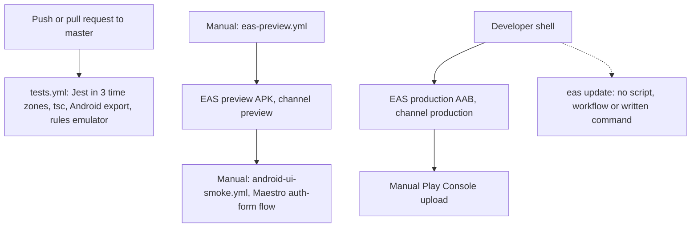

# Uptrack system design review, 22 October 2026

This covers the four areas the earlier reviews left out: the module dependency graph, the Firebase and Supabase project setup as far as the repo shows it, a scale and cost model, and the build and release design. It goes with `audit/REVIEW_2026-10.md` (`REV-nnn`), `audit/ARCHITECTURE_2026-10.md` (`ARCH-nnn`) and `audit/FOLLOWUP_2026-10-22.md` (`FUP-nnn`). New findings are `SYS-001` to `SYS-009`. No application code, configuration, rules or SQL was changed.

| Short | Stands for | In one line |
|---|---|---|
| EAS | Expo Application Services | Expo's build, submit and update service (`eas.json`) |
| OTA | Over-the-air update | A JS bundle published with `eas update`, delivered without a store release |
| AAB | Android App Bundle | The artifact uploaded to Google Play |
| App Check | Firebase App Check | Firebase service that rejects requests not coming from a genuine app build |
| DAU | Daily active users | Users who open the app on a given day |
| Fingerprint | `runtimeVersion.policy: "fingerprint"` | A hash of the native inputs; an OTA only reaches builds with the same hash |

## Scope and method

Code state: local `HEAD` `0028b20` (the `git pull` merge on top of `3eeb93d`), the same tree as the follow-up review.

| Command (repo root unless noted) | Result |
|---|---|
| `madge --ts-config tsconfig.json --extensions ts,tsx --exclude "\.test\.(ts|tsx)$" --circular src App.tsx` (scratch install under `%TEMP%`) | 298 files, no circular dependency |
| same with `--orphans` | 3 orphans: `App.tsx`, `src/features/profile/utils/testFixtures.ts`, `src/shared/firebase-auth.d.ts` |
| same with `--json`, then a `node` script over the graph | 921 import edges; per-feature edge counts, fan-in and fan-out below |
| `npx eas-cli@25.0.0 update --help`, `build:version:set --help`, `build:version:sync --help`, `fingerprint:compare --help` (scratch folder) | Flags quoted in SYS-007 and SYS-008 exist in the CLI version the workflows pin |
| Fetched `https://cloud.google.com/firestore/pricing` on 2026-10-22 | Prices quoted in the cost model |

Read for this pass: `eas.json`, `app.config.js`, `firebase.json`, `firebase/storage.rules`, the three workflows, `.maestro/`, `firebaseConfigService.ts`, `AuthContext.tsx`, `loadInitializationMeals.ts`, `mealService.ts`, `WorkoutContext.tsx`, `workoutHistoryQuery.ts`, `workoutTemplateService.ts`, `workoutSplitService.ts`, `useDashboardScheduledWorkout.ts`, `exerciseCatalogService.ts`, `exerciseImagePrefetch.ts`, `stepsSyncService.ts`, `learningCompletionService.ts`, `useFoodBackgroundEvaluations.ts`, `NutritionHandler.ts` and its test, `useFoodSearch.ts`, `queryClient.ts`, `docs/backend-structure.md`, `docs/PLAY_STORE_RELEASE_READINESS.md`, `docs/APP_FLOW_AUDIT_HANDOFF.md`.

Not run: any native build, `eas build`, `eas update`, a Firestore usage export, or anything against the live Firebase or Supabase projects. madge reads static imports only; whether it counted type-only imports was not checked (there are no cycles either way).

## Summary

9 findings: 0 High, 0 Medium, 7 Low, 2 Polish.

| ID | Area | Severity | One line |
|---|---|---|---|
| SYS-001 | Dependencies | Polish | `AuthContext` imports cache keys from nutrition and workout, so auth and those features depend on each other |
| SYS-002 | Dependencies | Low | The plan and progress calculation engines are spread over three feature folders that import each other |
| SYS-003 | Dependencies | Polish | Firebase setup and the `WorkoutSplit` type live in feature folders but are used app-wide |
| SYS-004 | Firebase setup | Low | No App Check, so anyone with the public config can run billed reads and writes against their own account |
| SYS-005 | Firebase setup | Low | Indexes, the Supabase search function and the deploy target are not in the repo |
| SYS-006 | Scale (incidental) | Low | A food search with no match returns 20 products that merely contain the first letter |
| SYS-007 | Release | Low | No iOS release path: no build number, no iOS submit config, no iOS workflow |
| SYS-008 | Release | Low | OTA updates are configured but have no procedure, no staged rollout and no rollback plan |
| SYS-009 | Release | Low | Production builds are started from a developer shell, so nothing ties them to a commit that passed CI |

Assessment: the system design fits a single-user app at its current size. The module graph has no cycles and `shared` almost never reaches into features. Firestore cost is small even for heavy users, and the main read driver is already reported (REV-019). The gaps are operational: the backend is not reproducible from git, and the release process for production builds and OTA updates exists only as manual steps nobody wrote down. None of this blocks the Android release; the release blockers remain REV-001, REV-006 and FUP-003. This pass is not exhaustive.

---

## 1. Module dependency graph

| Measure | Value |
|---|---|
| Files scanned (production `.ts`/`.tsx`, tests excluded) | 298 |
| Import edges | 921 |
| Circular imports | 0 |
| Orphans | 3, all expected: `App.tsx` is the root (imported by `index.ts`, outside the scan), `testFixtures.ts` is imported only by four test files, `firebase-auth.d.ts` is a declaration file |
| `shared` importing a feature | 1 edge: `src/shared/navigation/types.ts:2` imports `WorkoutSplit` from `features/workout/types.ts` |

Imports between features (count of edges, from the row to the column; `shared` omitted):

| From \ To | auth | nutrition | profile | workout | progress |
|---|---|---|---|---|---|
| auth | | 2 | | 1 | |
| nutrition | 10 | | 4 | | |
| profile | 5 | 2 | | 1 | |
| workout | 10 | | | | |
| dashboard | 1 | 4 | 2 | 8 | 1 |
| progress | 1 | 4 | 3 | 5 | |

Most imported files: `shared/theme/index.ts` (107), `shared/types.ts` (79), `shared/theme/createStyles.ts` (66), `features/workout/types.ts` (40), `shared/navigation/index.ts` (35), `shared/hooks/useResponsive.ts` (22), `features/auth/services/firebaseConfigService.ts` (20), `features/nutrition/utils/dateUtils.ts` (19).

Most imports out: `App.tsx` (34), `FoodContext.tsx` (22, consistent with ARCH-002), `DashboardScreen.tsx` and `FoodSelectionScreen.tsx` (19 each).

The two-way pairs at feature level are auth and nutrition, auth and workout, and nutrition and profile. None of them is a file-level cycle.

### SYS-001 `AuthContext` imports cache keys from nutrition and workout
- Severity: Polish
- Confidence: Confirmed
- Where: `src/features/auth/context/AuthContext.tsx:8-10,127`
- What happens: To clear device-wide caches on sign-out, `AuthContext` imports `RECENT_SEARCHES_KEY` from `nutrition/helpers/useRecentSearches`, `SPLITS_CACHE_KEY` from `workout/services/splitCache` and `deriveStartWeight` from `nutrition/helpers/learningCompletionService`. Those features also import `AuthContext`, so auth depends on them and they depend on auth.
- Why it matters: Not much today. Every new device-wide cache has to be added to this file, which `AGENTS.md` already says. It would matter if a feature were ever split out or lazy-loaded.
- Suggested fix: Leave it. If the coach work in `ARCHITECTURE_2026-10.md` adds more device-wide caches, move the storage keys into one `src/shared/storageKeys.ts` at that point, in its own commit.
- Effort: S

### SYS-002 The plan and progress engines live in three feature folders that import each other
- Severity: Low
- Confidence: Confirmed
- Where: `profile/utils/nutritionPlanEngine.ts`, `profile/utils/weightTrendEngine.ts`, `profile/utils/maintenanceEstimator.ts`, `nutrition/helpers/stepStats.ts`, `nutrition/helpers/phaseService.ts`, `progress/utils/progressEngine.ts`
- What happens: Nutrition imports the profile engines (`learningCompletionService.ts`, `phaseService.ts`, `WeightTracker.tsx`). The profile engines import `nutrition/helpers/stepStats.ts` (`maintenanceEstimator.ts`, `nutritionPlanEngine.ts`). Progress and Dashboard import all of them. These are pure calculation modules, the core logic of the app, filed under whichever screen first needed them.
- Why it matters: The coach design in `ARCHITECTURE_2026-10.md` shows a client's targets and trends to a coach, so the same calculations will run on another user's data from a new feature folder. That adds a fourth feature to the web of imports.
- Suggested fix: Owner decision, and only when the coach work starts. Move the six files into `src/domain/` with `git mv` (so `git log --follow` keeps history), update imports, no logic changes. Check with `tsc`, Jest and madge `--circular`.
- Effort: M (mechanical)

### SYS-003 App-wide infrastructure and a shared type live in feature folders
- Severity: Polish
- Confidence: Confirmed
- Where: `src/features/auth/services/firebaseConfigService.ts` (imported by 7 nutrition, 7 workout and 3 profile files), `src/shared/navigation/types.ts:2`, `src/features/workout/types.ts`
- What happens: The Firebase app, auth and database singletons sit in the auth feature. `WorkoutSplit` is used by `shared/navigation`, Dashboard and Progress, but is declared in the workout feature. `AGENTS.md` says shared shapes belong in `src/shared/types.ts`.
- Why it matters: Only readability. It is the one place where `shared` depends on a feature.
- Suggested fix: Leave `firebaseConfigService.ts` where it is; moving it touches 20 imports for no behavior gain. Move `WorkoutSplit` (and the types it needs) into `src/shared/types.ts` the next time workout types are edited.
- Effort: S

---

## 2. Firebase and Supabase project setup

What the repo shows:

| Item | State | Where |
|---|---|---|
| Firebase SDK init | JS SDK, `initializeAuth` with AsyncStorage persistence, `getFirestore` with the default memory cache | `firebaseConfigService.ts:42-56` |
| Config source | EAS environment variables copied into `extra`; the app throws at import if the API key or project id is missing (REV-003) | `app.config.js:74-90`, `firebaseConfigService.ts:28-30` |
| Environments | Three EAS environments (`development`, `preview`, `production`) with the same 15 variable names | `eas.json:10,18,25`, `docs/PLAY_STORE_RELEASE_READINESS.md:48` |
| Deploy target | No `.firebaserc`; `firebase.json` names the rules files and emulator ports only | `firebase.json:1-19` |
| Firestore indexes | No `firestore.indexes.json`; composite indexes exist in the console and are listed by hand | `docs/backend-structure.md:53-66` |
| Rules | In git, tested against the emulator (`npm run test:rules`); no `get()` or `exists()` calls, so rules add no billed reads | `firebase/firestore.rules` |
| Storage | Profile pictures only, under 5 MB and `image/*` by rule; picked with a square crop at quality 0.8, not resized | `firebase/storage.rules:11-12`, `ProfileScreen.tsx:107-109` |
| App Check | Not initialized anywhere in `src/` | search for `initializeAppCheck` and `app-check` |
| Analytics | `firebaseMeasurementId` is passed through, but nothing imports `firebase/analytics` | `app.config.js:86` |
| Backend code | None (no `functions/`), see ARCH-006 | |
| Supabase | Anon key; RLS policies in `supabase/rls.sql`; the `search_products_similarity` function and the trigram indexes exist only in the live database | `supabase/`, `docs/backend-structure.md:92,100` |

Whether `development` and `production` point at different Firebase and Supabase projects cannot be seen from the repo. If they share one project, dev builds and test accounts write into production data. Owner check below.

### SYS-004 No App Check, so the public config is enough to run billed traffic
- Severity: Low
- Confidence: Confirmed (absence); impact depends on someone abusing it
- Where: `src/features/auth/services/firebaseConfigService.ts` (no App Check), `app.config.js:80-86`
- What happens: The Firebase config ships in every build, which is normal. Email sign-up is open. With no App Check, a script can create accounts and then read and write its own documents as fast as it likes. The rules keep it inside its own data, so nothing leaks, but every read is billed to the project. The pricing page fetched on 2026-10-22 also says requests keep succeeding after a budget is exceeded; budgets only alert.
- Why it matters: Cost and quota abuse, not data exposure. The same gap makes the coach share-code guessing in `ARCHITECTURE_2026-10.md` easier to script.
- Suggested fix: Owner decision, tied to the offline decision in ARCH-007. App Check needs a platform attestation provider (Play Integrity on Android, App Attest or DeviceCheck on iOS). From general knowledge, not checked in this session, the JS SDK has no built-in provider for React Native, and the usual route is `@react-native-firebase/app-check`, which brings in the native Firebase SDK. Interim, in the console: a budget with alerts, and a usage alert on Firestore reads.
- Effort: L (with the native SDK), S (budget alert)

### SYS-005 The backend cannot be rebuilt from git
- Severity: Low
- Confidence: Confirmed
- Where: `firebase.json:2-4` (no `indexes` entry, no `.firebaserc`), `docs/backend-structure.md:53-66,92`, `supabase/rls.sql` (only file in `supabase/`)
- What happens: The composite indexes, the Supabase search function and its indexes exist only in the live projects. `docs/backend-structure.md` lists them by hand; the 2026-10-16 export it was checked against had index definitions truncated. A rules deploy goes to whatever project the deployer's Firebase CLI is set to, since there is no project alias in the repo.
- Why it matters: A staging project, a second region or a restore after a mistake would have to be rebuilt from notes. A query whose index is missing fails at runtime, not in tests.
- Suggested fix: The owner runs these reads and commits the output (use `cmd` or Git Bash; PowerShell `>` writes UTF-16):

```bash
npx --yes firebase-tools@15.34.0 firestore:indexes --project <production project id> > firebase/firestore.indexes.json
```

Then reference the file from `firebase.json`:

```json
{
  "firestore": {
    "rules": "firebase/firestore.rules",
    "indexes": "firebase/firestore.indexes.json"
  },
  "storage": {
    "rules": "firebase/storage.rules"
  },
  "emulators": {
    "firestore": {
      "port": 8080
    },
    "storage": {
      "port": 9199
    },
    "ui": {
      "enabled": false
    }
  }
}
```

For Supabase, run in the SQL editor and save the output under `supabase/`:

```sql
select pg_get_functiondef(p.oid)
from pg_proc p
join pg_namespace n on n.oid = p.pronamespace
where n.nspname = 'public' and p.proname = 'search_products_similarity';

select tablename, indexname, indexdef
from pg_indexes
where schemaname = 'public' and tablename in ('non_barcoded_products', 'barcoded_products');
```

Pass `--project` explicitly on every `firebase deploy` instead of relying on CLI state. A `.firebaserc` would hold the project id, which ships in the app anyway, so committing it is safe. Whether to commit it is the owner's call.
- Effort: S

---

## 3. Scale and cost model

### Reads per action, traced from code

| Action | Firestore document reads | Where |
|---|---|---|
| Cold start, users document | 1 | `AuthContext.tsx:74` |
| Cold start, meals | days logged in the last 31 days (one query, always runs even when the AsyncStorage cache is shown first) | `loadInitializationMeals.ts:23`, `mealService.ts:112-116` |
| Cold start, workout history | min(workouts, 100) | `WorkoutContext.tsx:73,152`, `workoutHistoryQuery.ts:21,55-59` |
| Cold start, templates | number of templates, once per 5 minutes across callers | `WorkoutContext.tsx:126,153`, `workoutTemplateService.ts:101-105` |
| Dashboard, splits | number of splits, when the 15-minute AsyncStorage split cache is stale | `useDashboardScheduledWorkout.ts:12,63-83`, `workoutSplitService.ts:37-53` |
| Exercise picker | muscle-group documents plus custom exercises, at most every 12 hours | `exerciseCatalogService.ts:24,42-50`, called only from `useExerciseCatalog.ts:19` |
| Progress visit | meals since the phase started, plus every workout of the last 104 weeks (REV-019, REV-020) | `ProgressScreen.tsx` |
| Weekly evaluation | 1 users read, at most once per 6 days | `learningCompletionService.ts:119` |
| App resume from background | 0; nothing refetches on `AppState` change | search for `AppState` |
| Realtime listeners | none; no `onSnapshot` in `src/` | |

Each query costs at least one read even when it returns nothing (pricing page). The TanStack Query cache is in memory only (`queryClient.ts:9`), so every cold start pays the full startup cost again.

### Example: a heavy user

Assumptions, not measurements: logs food every day, 4 workouts a week for a year (208 workouts), 5 templates, 2 splits, a one-year phase, 3 cold starts and 1 Progress visit a day, about 9 writes a day.

- Cold start: 1 + 31 + 100 + 5 + 2 = 139 reads.
- Progress visit: up to 365 + 208 = 573 reads.
- Day: 3 x 139 + 573 = 990 reads. Month (30 days): 29,700 reads.

Prices from the Firestore Standard pricing page, fetched 2026-10-22, for Iowa (`us-central1`); the project's region is not in the repo and prices vary by region. Free quota per day: 50,000 reads, 20,000 writes, 1 GiB stored, 10 GiB a month outbound. Beyond that: $0.03 per 100,000 reads, $0.09 per 100,000 writes.

| Heavy users per day | Reads per month | Read cost per month |
|---|---|---|
| 50 | 1.49 M | inside the free quota |
| 1,000 | 29.7 M | about $8.50 |
| 10,000 | 297 M | about $89 |

At 10,000 such users, writes come to about 2.7 M a month, about $2 beyond the free quota. Bandwidth was not modelled because document sizes were not measured.

What this means:
- Cost is not a design driver at any size this app is likely to reach soon. Do not change the startup loading for cost reasons.
- Progress visits are about 58% of this user's reads and the startup history page about 30%.
- The REV-019 fix as written caches the closed meal range in memory. It saves reads on repeat visits within one session but not across cold starts. If the read count matters, the closed range has to be persisted per user (as `MealCache` does) and added to the sign-out clearing. Record this with the REV-019 decision.
- The real cost risk is unbounded traffic from scripts (SYS-004), not normal use.

### What grows per user

| Data | Growth | Bounded? |
|---|---|---|
| `meals` | one document per logged day | Paged by date range; fine |
| `workoutHistory` | one document per workout | Paged, 100 per page; fine |
| `users/{uid}` | `dailySteps` gains one key per day (backfilled from 2026-01-01, `stepsSyncService.ts:6`); `weeklyNutrition` gains one entry a week and is never trimmed (`learningCompletionService.ts:127-130`); `weightIns` and `phaseHistory` also grow | Unbounded but slow. Firestore's 1 MiB document limit (general knowledge) is far away for years of data; sizes were not measured. Every read of the users document downloads all of it |
| Profile picture | one file, overwritten | Under 5 MB by rule; not resized on upload |

### Supabase

Each executed food search is one RPC (`NutritionHandler.ts:120-125`). It runs one or two more queries only when the RPC returns nothing or fails (`NutritionHandler.ts:132-168`). Input is debounced by 300 ms, needs at least 2 characters, and results are cached for 5 minutes per query text (`useFoodSearch.ts:103-111`, `NutritionHandler.ts:31-49`). Load scales with searches, not users. The Supabase plan and its limits are not in the repo.

### SYS-006 A search with no match returns 20 products containing its first letter
- Severity: Low
- Confidence: Confirmed (code); how often it happens depends on the RPC's 0.1 similarity threshold
- Where: `src/features/nutrition/handlers/NutritionHandler.ts:164-174`, asserted by `NutritionHandler.test.ts:143-153`
- What happens: When the similarity RPC and the term search both return nothing, `performEnhancedSearch` runs `ilike '%<first character>%'` with a limit of 20 and returns that. A typo such as "qwxz" shows 20 foods that contain a "q". The fallback also ignores the caller's limit (8 for suggestions, `useFoodSearch.ts:127-129`).
- Why it matters: The user sees results unrelated to what they typed, with no "no results" state, and may log a wrong food. It also costs a third round trip.
- Suggested fix: Owner decision, because a test asserts the current behavior on purpose. If the answer is "show nothing", replace the loose query with `return [];` and change the test to expect an empty result and two `or()` filters.
- Effort: S

---

## 4. Build and release design



- Solid arrows are what exists. The dotted arrow is possible with the current config but has no procedure.
- Nothing connects `tests.yml` to either build. CI checks the commit; the builds do not check CI.

| Item | State | Where |
|---|---|---|
| Build profiles | `development` (dev client, APK), `preview` (APK), `production` (AAB); each sets an EAS environment and a channel of the same name | `eas.json:6-31` |
| Version source | `appVersionSource: "local"`, no `autoIncrement` | `eas.json:4` |
| Android version | `versionCode: 3`, bumped by hand (REV-004) | `app.config.js:67` |
| iOS version | no `ios.buildNumber` | `app.config.js:39-51` |
| Submit | `submit.production` is empty | `eas.json:32-34` |
| Runtime version | fingerprint policy; updates URL set | `app.config.js:102-107` |
| `expo-updates` | installed (`package.json:42`); the app uses it only for `reloadAsync` in the error boundary, with default update checking | `ErrorBoundary.tsx:4,17` |
| Workflows | `tests.yml` on push, pull request, weekly schedule; `eas-preview.yml` and `android-ui-smoke.yml` manual, behind a confirm input and the `eas-preview` GitHub environment | `.github/workflows/` |
| UI tests | one Maestro flow, auth form validation only; next flows listed in `docs/ANDROID_UI_AUTOMATION.md:25-28` | `.maestro/flows/auth-form-validation.yaml` |
| Supply chain | actions pinned by tag; Maestro installed with `curl | bash` (`android-ui-smoke.yml:104`). Already recorded as accepted risk in `docs/APP_FLOW_AUDIT_HANDOFF.md:52` | |

### SYS-007 There is no iOS release path
- Severity: Low
- Confidence: Confirmed (config); the default build number is general knowledge
- Where: `app.config.js:39-51`, `eas.json:3-4,24-30,32-34`
- What happens: The iOS config has a bundle id, Apple sign-in and HealthKit strings, but no `buildNumber`. The production profile has no iOS settings, submit is empty, and no workflow or doc covers TestFlight. With a local version source and no build number, Expo uses a default build number (from general knowledge, "1"; not checked). App Store Connect rejects a second upload with the same version and build number.
- Why it matters: The first iOS upload works, the second fails until someone adds the field by hand. iOS release is also blocked by REV-006 (Apple deletion) and FUP-003 (HealthKit prompt at launch), so this is not urgent.
- Suggested fix: Decide together with REV-004. One change covers both platforms: let EAS own the build numbers. `eas build:version:set` and `build:version:sync` exist in eas-cli 25.0.0 for setting the starting value and copying it back. Complete `eas.json`:

```json
{
  "cli": {
    "version": ">= 9.2.0",
    "appVersionSource": "remote"
  },
  "build": {
    "development": {
      "developmentClient": true,
      "distribution": "internal",
      "environment": "development",
      "android": {
        "buildType": "apk"
      },
      "channel": "development"
    },
    "preview": {
      "distribution": "internal",
      "environment": "preview",
      "android": {
        "buildType": "apk"
      },
      "channel": "preview"
    },
    "production": {
      "environment": "production",
      "autoIncrement": true,
      "android": {
        "buildType": "app-bundle"
      },
      "channel": "production"
    }
  },
  "submit": {
    "production": {}
  }
}
```

Before the first remote build, set the starting Android value above 3 with `npx eas-cli@25.0.0 build:version:set --platform android --profile production`. The `versionCode` in `app.config.js` then stops being the source of truth; `releaseConfig.test.ts:13-17` still passes but no longer guards anything. Trade-off: the number lives on EAS, not in git.
- Effort: S

### SYS-008 OTA updates are configured but have no procedure
- Severity: Low
- Confidence: Confirmed (absence); the impact depends on the first update ever published
- Where: `app.config.js:102-107`, `eas.json` channels, no `eas update` in `package.json`, `.github/workflows/` or `docs/`
- What happens: Every build listens on a channel and the fingerprint policy keeps updates away from incompatible binaries. But nothing says how to publish. Risks when someone does it by hand:
  - publishing from a shell without the production EAS environment ships empty `extra` values, which crash the app at import (REV-003);
  - publishing from an environment whose Google services file differs from the build's gives a different fingerprint, so the update silently reaches nobody (`docs/APP_FLOW_AUDIT_HANDOFF.md:137`);
  - an update goes to 100% of users on that runtime unless `--rollout-percentage` is passed;
  - updates are not code-signed (`docs/APP_FLOW_AUDIT_HANDOFF.md:239`);
  - with no crash reporting (REV-030), a bad update is noticed only through `eas update:insights`, if someone looks.

  From general knowledge, not checked here: `expo-updates` falls back to the previous update when a new one crashes before the first screen renders, which limits the worst case.
- Why it matters: OTA is the fastest way to ship a fix, and the fastest way to break every installed copy at once.
- Suggested fix: Owner decision on whether OTA is used at all. If yes, add a manual workflow like the preview one. Every flag below is in `eas update --help` for eas-cli 25.0.0. It needs an `eas-production` GitHub environment holding `EXPO_TOKEN`, ideally with a required reviewer. `.github/workflows/eas-update.yml`:

```yaml
name: EAS production update

on:
  workflow_dispatch:
    inputs:
      message:
        description: "Update message shown in the EAS dashboard"
        required: true
        type: string
      rollout_percentage:
        description: "Share of production users who get this update first"
        required: true
        type: choice
        options:
        - "10"
        - "50"
        - "100"
        default: "10"
      confirm_production_update:
        description: "Publish this commit as an over-the-air update to production builds with a matching runtime"
        required: true
        type: boolean
        default: false

permissions:
  contents: read

jobs:
  update:
    if: ${{ inputs.confirm_production_update }}
    runs-on: ubuntu-latest
    timeout-minutes: 45
    environment: eas-production

    steps:
    - uses: actions/checkout@v4

    - name: Use Node.js 22.x
      uses: actions/setup-node@v4
      with:
        node-version: 22.x
        cache: 'npm'

    - name: Install dependencies
      run: npm ci --legacy-peer-deps

    - name: Unit tests
      run: npm test -- --ci

    - name: Type check
      run: npx tsc --noEmit

    - name: Verify EAS token is configured
      env:
        EXPO_TOKEN: ${{ secrets.EXPO_TOKEN }}
      run: |
        if [ -z "$EXPO_TOKEN" ]; then
          echo "::error title=Missing secret::Set EXPO_TOKEN in the eas-production GitHub environment before running this workflow."
          exit 1
        fi

    - name: Publish production update
      env:
        EXPO_TOKEN: ${{ secrets.EXPO_TOKEN }}
        UPDATE_MESSAGE: ${{ inputs.message }}
        ROLLOUT_PERCENTAGE: ${{ inputs.rollout_percentage }}
      run: npx --yes eas-cli@25.0.0 update --channel production --environment production --message "$UPDATE_MESSAGE" --rollout-percentage "$ROLLOUT_PERCENTAGE" --non-interactive
```

Release doc steps to add next to it:
1. Before the first publish, compare fingerprints: `npx eas-cli@25.0.0 fingerprint:compare --build-id <production build id> --environment production`. Whether it exits non-zero on a mismatch was not checked, so read its output.
2. After publishing, watch `npx eas-cli@25.0.0 update:insights` for the update group, then publish again at 100% or roll back with `update:rollback` / `update:republish`.

The two known auth-test timeouts (FUP-007) can fail the test step; re-run the job if so, or fix FUP-007 first.
- Effort: S (workflow), owner setup for the GitHub environment

### SYS-009 Production builds are not tied to a commit that passed CI
- Severity: Low
- Confidence: Confirmed (no workflow); how builds are started today is inferred from the docs
- Where: `.github/workflows/` (no production build), `docs/TESTING_AND_CI_STRATEGY.md:118`, `docs/PLAY_STORE_RELEASE_READINESS.md:21`
- What happens: The preview build has a workflow; the production AAB does not. A production build started from a developer shell builds whatever that working tree holds, which may be uncommitted or not yet checked by `tests.yml`.
- Why it matters: The artifact sent to Play may differ from what CI checked, and nobody can tell from the repo which commit a store build came from.
- Suggested fix: Owner decision. A manual production build workflow (same shape as `eas-preview.yml`, `--profile production`, the test and `tsc` steps first, the `eas-production` environment) keeps Play upload manual, as `docs/TESTING_AND_CI_STRATEGY.md:118` asks, while making the build reproducible. At minimum, write the build command and "from a clean checkout of a green commit" into the release checklist.
- Effort: S

---

## Owner decisions

1. Whether to move the calculation engines into `src/domain/` when the coach work starts (SYS-002).
2. App Check and the native Firebase SDK, together with the offline decision (SYS-004, ARCH-007). Budget and usage alerts in the meantime.
3. Whether to commit the index export, the Supabase function definition and a `.firebaserc` (SYS-005).
4. What a search with no match should show (SYS-006).
5. Remote version source with auto-increment for both platforms, or manual bumps on a checklist (SYS-007 with REV-004).
6. Whether to use OTA updates, and if so the default rollout percentage and who approves a publish (SYS-008).
7. Whether production builds run from a workflow (SYS-009).
8. Whether the REV-019 fix should persist the closed meal range across cold starts, given the cost model above.

## Owner checks (console only, not readable from the repo)

- Do the `development`, `preview` and `production` EAS environments point at different Firebase and Supabase projects? Compare the project id names in the EAS dashboard without copying values.
- Firestore database location, which sets the actual prices.
- Whether a Google Cloud budget and alerts exist.
- Supabase plan and its limits.
- Size of the largest `users` document in the Firestore console.
- Whether any OTA update has already been published to the `production` channel (`npx eas-cli@25.0.0 update:list`).

## Not verified

- Any number in the cost model beyond the code trace: document sizes, real launch counts and the actual region.
- Exact Expo defaults for a missing iOS `buildNumber` and the `expo-updates` crash fallback (general knowledge).
- `@react-native-firebase/app-check` as the App Check route for this app (general knowledge).
- Whether madge counted type-only imports.
- Behavior of `eas fingerprint:compare` on a mismatch, and how EAS file variables such as `GOOGLE_SERVICES_JSON` resolve during `eas update`.
- Live Firebase and Supabase state of any kind.
